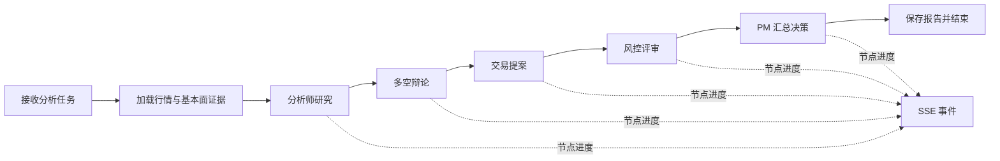

# FinAgent Lab 真实多智能体工作流实施路线

## 目标

将当前前端模拟的六阶段投研流程，逐步替换为 FastAPI 后端实际执行的 LangGraph 工作流。每个阶段完成后先达到验收条件，再进入下一阶段，避免一次性搭建过多模块。

## 当前状态

| 能力 | 当前状态 |
| --- | --- |
| 股票搜索、行情快照、日/周/月 K 线 | 已由 FastAPI 行情接口提供，K 线支持按日期范围查询 |
| K 线周期日期选择、窗口摘要 | 前端已实现，选定日期会重新请求对应周期的数据 |
| 六阶段分析页面 | 工作台、研究报告、历史任务、模拟交易四页均已实现 |
| 任务、事件、证据和报告模型 | 已定义初稿，任务请求支持周期和日期区间 |
| LangGraph 共享 AgentState | 已按 MessagesState、辩论子状态和工具调用计数定义初稿 |
| Agent 数据流模块 | 已按行情 K 线、基本面和新闻拆分；由上下文构建器统一编排 |
| 分析上下文数据流 | K 线按用户区间读取；历史任务按披露日整理基本面、按发布时间整理新闻和巨潮公告，并标注覆盖限制；历史实时估值快照暂不可回溯 |
| 前端数据接入阶段 | 「开始分析」创建后台任务并订阅 SSE 实时更新；刷新页面会自动恢复上次任务（运行中续订、已完成直接展示），工具栏提供最近任务列表 |
| 分析师研报 | 行情、基本面、新闻情绪三个分析师均已接入真实模型，共用工具调用运行时（证据引用校验 + JSON 格式纠正） |
| LangGraph 执行图 | 完整链路：接入 → 三个分析师 → 多空辩论（条件边控制轮次）→ 交易员 → 三类风控 → PM；统一通过任务接口执行 |
| 多空辩论 / 交易 / 风控 / PM | 已接入真实模型：Bullish/Bearish 各 3 次发言（发言计数终止）、TradeProposal、三类 RiskReview、PMDecision |
| 缓存 | 支持进程内 / Redis 两种后端；K 线按 (代码, 周期) 缓存完整序列，图表与分析共用一次取数 |
| 分析任务 API、真实 SSE | 已实现 `POST /tasks`、`GET /tasks/{id}`、`GET /tasks/{id}/events`（SSE，支持 Last-Event-ID 断线续传）、`POST /tasks/{id}/cancel`；任务表当前在进程内 |
| 任务与报告持久化 | 已写入 MongoDB（`analysis_tasks` 集合），重启后可查询；不可用时回退内存，运行中任务重启后标记 interrupted |
| 运行评测 | 已实现 `backend/scripts/run_evaluation.py`：4 个固定样例成功率 100%，平均 90.8s、17.8 次模型调用，证据引用覆盖率 100% |

## 目标工作流

分析流程由代码控制节点顺序、辩论轮数和结束条件；大模型负责分析与解释。模型输出必须经过结构校验，行情或新闻缺失时明确标记缺失，不能编造数据。

## 分阶段实施

### 第 1 阶段：定义数据契约与配置

**工作内容**

- 定义分析任务请求、任务状态、阶段事件和最终报告的 Pydantic 模型。
- 定义统一的 AgentState，记录股票代码、交易日期、输入证据、阶段输出、错误和运行信息。
- 统一模型配置入口；密钥只从后端环境变量或本地配置读取，不传到前端。
- 为每条外部数据记录来源与更新时间。

**验收条件**

- 一个任务请求和一个阶段结果都能通过模型校验。
- 错误、缺失数据和正常结果有明确且一致的数据结构。
- 仓库中没有提交真实 API 密钥。

### 第 2 阶段：打通一个真实 Agent

**工作内容**

- 复用现有行情服务，先构造单只股票、指定日期的分析上下文。
- 接入一个大模型分析节点，优先完成市场分析师。
- 要求模型按 Pydantic 结构返回结论、理由和引用的数据证据。
- 记录模型、耗时、输入数据日期和失败原因。

**验收条件**

- 前端或 API 调用后能获得一次真实模型输出，而非预设文案。
- 输出中的行情事实能对应到实际传入的数据和来源。
- 模型超时或输出格式错误时，接口返回可识别的失败状态。

### 第 3 阶段：构建 LangGraph 多阶段流程

**工作内容**

- 将分析师、辩论、交易提案、风控和 PM 决策拆成独立节点。
- 先用固定顺序和固定辩论轮数，之后再按需要增加条件分支或并行分析。
- 使用统一 AgentState 在节点间传递结构化结果。
- 将风险限制和流程终止条件放在代码中；模型给出判断与理由。

**验收条件**

- 节点按预期顺序运行，辩论轮数达到上限后能稳定结束。
- 上游节点失败时，任务状态和错误信息清楚，不会生成看似成功的 PM 决策。
- 最终报告可以追溯到各阶段输入与输出。

### 第 4 阶段：实现分析任务管理

**建议接口**

- `POST /api/agent/tasks`：创建任务并返回任务 ID。
- `GET /api/agent/tasks/{task_id}`：查询状态和最终结果。
- `GET /api/agent/tasks/{task_id}/events`：订阅任务事件。
- `POST /api/agent/tasks/{task_id}/cancel`：请求取消运行中的任务。

**验收条件**

- 任务有明确的等待、运行、成功、失败和取消状态。
- 页面刷新后可凭任务 ID 查询状态或结果。
- 重复订阅事件不会重复启动同一个任务。

### 第 5 阶段：前端改用真实事件

**工作内容**

- 将 `frontend/src/features/analysis/pipeline.js` 中的模拟等待和预设生成逻辑替换为任务 API 与 EventSource。
- 将后端事件映射到现有阶段进度、事件日志和报告组件。
- 展示任务失败、取消、断线重连和重新订阅状态。

**验收条件**

- 页面中的阶段变化与后端实际 LangGraph 节点执行一致。
- 浏览器网络面板能看到真实任务请求和 SSE 事件。
- 分析结束后页面展示后端返回的最终结果。

### 第 6 阶段：持久化、稳定性与评测

**工作内容**

- 保存任务输入、阶段结果、错误、数据来源和最终报告。
- 为模型调用配置超时、有限重试和明确的降级状态。
- 选取一组固定股票与日期，记录结构化输出成功率、数据覆盖率、耗时和模型成本。
- 对照实际实现更新 README 和简历；只有已实现并可演示的能力才写成完成成果。

**验收条件**

- 服务重启后仍能查询已完成任务与报告。
- 每次降级都能在结果和事件记录中看见原因。
- 评测结果可复现，简历中的数字能说明样本、口径和测量方式。

## 开发约定

- 一次只推进一个阶段；提交前检查代码、配置示例和文档是否同步。
- 大模型输出不直接当作真实行情事实；事实要能回溯到数据源和时间。
- 用户提供的参考项目用于理解工作流设计。复制代码前逐目录核对许可证；其 README 标明部分目录受专有许可约束。
- 不接入真实下单；交易提案只作为研究结果展示。

## 下一步

六阶段链路已在 LangGraph 中跑通：三个分析师共用 `tool_agent_runtime`（工具循环、证据校验、JSON 纠正），研究员、交易员、风控与 PM 共用 `run_structured_completion`（单次结构化调用 + 纠错）；辩论用条件边按发言计数终止。

下一步：部署与多 worker——任务表与 SSE 事件改用 Redis/Mongo 广播，支撑多进程运行；补 Docker Compose（后端 + 前端 + Redis + MongoDB）；再按评测结果调优提示词与成本。
